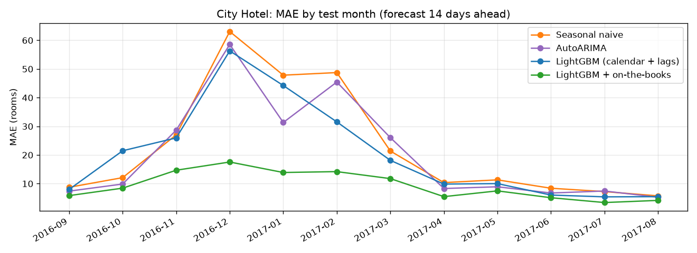
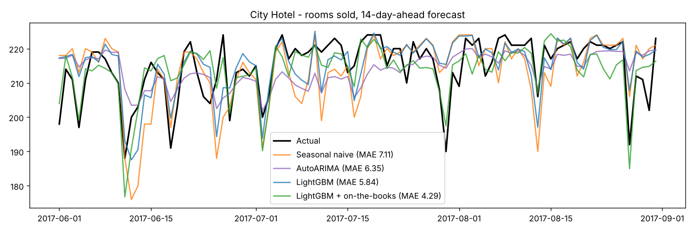

# Hotel Demand Forecasting & Price Suggestion

Forecast how many rooms a hotel will sell each day, 14 days ahead, then suggest a room price from that forecast.

## Problem

Hotels need to know future demand early to set prices and plan staff. This project:

1. Turns 119k booking records into a daily "rooms sold" time series per hotel.
2. Compares a seasonal naive baseline, AutoARIMA and LightGBM, with and without **on-the-books** data
   (rooms already booked, the main signal hotels use in practice).
3. Uses the forecast to suggest a daily price (simple, explainable rules).

## Data

[Hotel Booking Demand](https://www.kaggle.com/datasets/jessemostipak/hotel-booking-demand) (Antonio, Almeida & Nunes, 2019): bookings of a city hotel and a resort hotel in Portugal, arrivals from Jul 2015 to Aug 2017.

Download `hotel_bookings.csv` and put it in `data/raw/`.

## Key findings from EDA

Full analysis: [`notebooks/01_eda.ipynb`](notebooks/01_eda.ipynb)

- 42% of City Hotel and 28% of Resort Hotel bookings are canceled; the longer the lead time, the higher the cancel rate (10% → 68%).
- Strong yearly cycle: the City Hotel sells ~105 rooms/day in January vs ~218 in August. Both hotels are often full in summer.
- Price follows demand: Resort Hotel ADR goes from ~53 EUR in winter to ~190 EUR in August. When the hotel is full, ADR still varies a lot, so there is room to raise prices on forecast "full" days.

## Method

| Step | Detail |
|---|---|
| Daily series | Non-canceled bookings, each counts as 1 room per night of stay |
| Split | Train 2015-08 → 2017-02 (first month skipped: incomplete), Valid 2017-03 → 05, Test 2017-06 → 08 |
| Features | Weekday, month, day of year, lags ≥ horizon (no leakage), rolling mean/std |
| On-the-books | Rooms already booked for the date, as known 14 days before (booking date = arrival − lead time; canceled bookings count until their cancel date) + the same booked/actual ratio one year earlier |
| Models | Seasonal naive (same weekday, 14 days earlier) · AutoARIMA (weekly season, rolling origin) · LightGBM on the residual (actual − naive, early stopping) |
| Evaluation | Every test day is forecast exactly 14 days ahead, for all models. Two tests: summer only (Jun–Aug 2017) and a 12-month rolling backtest (Sep 2016 → Aug 2017) |
| Pricing | Occupancy = forecast (LightGBM + on-the-books) / capacity (95th percentile of rooms sold) → price multiplier |

## Results

### 1. Full year: rolling backtest (Sep 2016 → Aug 2017, horizon = 14 days)

Each month is a test fold: train on everything before, early stopping on the 2 months before, then forecast every day of the month 14 days ahead.
MAE is over all 365 test days.

| Hotel | Seasonal naive | AutoARIMA | LightGBM (calendar + lags) | **LightGBM + on-the-books** |
|---|---|---|---|---|
| City Hotel | 22.5 | 20.2 | 20.2 | **9.3** (−59%) |
| Resort Hotel | 18.9 | 17.5 | 15.6 | **9.3** (−51%) |

- With on-the-books, LightGBM beats the baseline in 12/12 months (City) and 11/12 months (Resort).
- Without it, the model is weak in low season: in Dec 2016 the City Hotel MAE is 56 rooms vs 18 with on-the-books.
  In Oct 2016 the first LightGBM was even worse than the baseline (21.5 vs 12.1).



### 2. Summer only (Jun–Aug 2017, horizon = 14 days)

| Hotel | Model | MAE | RMSE | MAPE |
|---|---|---|---|---|
| City Hotel | Seasonal naive | 7.11 | 9.64 | 3.37% |
| City Hotel | AutoARIMA | 6.35 | 8.21 | 3.01% |
| City Hotel | LightGBM (calendar + lags) | 5.84 | 7.60 | 2.78% |
| City Hotel | **LightGBM + on-the-books** | **4.29** | **5.51** | **2.03%** |
| Resort Hotel | Seasonal naive | 5.67 | 7.52 | 3.25% |
| Resort Hotel | AutoARIMA | 4.88 | 6.12 | 2.78% |
| Resort Hotel | LightGBM (calendar + lags) | 4.76 | 6.36 | 2.75% |
| Resort Hotel | **LightGBM + on-the-books** | **3.92** | **5.16** | **2.25%** |

In summer both hotels are almost full, so every model looks good. This is why the full-year backtest matters:
the first version showed −18% MAE on summer data but only −10% (City) over a whole year.



## How to run

```bash
python -m venv .venv
.venv\Scripts\activate            # Windows
pip install -r requirements.txt

# Optional: test with fake data first
python src/sample_data.py

python src/data_prep.py           # -> data/processed/daily_demand.csv
python src/train.py --hotel "City Hotel"
python src/train.py --hotel "Resort Hotel"
python src/backtest.py --hotel "City Hotel"            # 12-month backtest
python src/backtest.py --hotel "City Hotel" --arima    # + AutoARIMA (slow)
python -m pytest -q
```

Outputs go to `reports/`: metrics (JSON), forecast + suggested price per day (CSV), charts (PNG),
and `backtest_*.csv/json/png` for the 12-month backtest.

### Optional: BigQuery ML

`bigquery/` has an upload script and ARIMA_PLUS SQL to run the same comparison in BigQuery ML
(works in the free BigQuery sandbox). Not run yet.

## Project structure

```
src/
  config.py       settings (paths, split dates, horizon)
  data_prep.py    bookings -> daily series, on-the-books series
  features.py     calendar, lag and on-the-books features
  models.py       seasonal naive, residual LightGBM
  arima.py        AutoARIMA (statsforecast), rolling origin
  evaluate.py     MAE, RMSE, MAPE
  pricing.py      price suggestion rules
  train.py        full pipeline (summer test + price suggestion)
  backtest.py     12-month rolling backtest
notebooks/        EDA
bigquery/         optional BigQuery ML scripts
tests/            unit tests
```

## Lesson learned

The first version trained LightGBM on the raw target and dropped every row with a missing `lag_364`.
That left only 245 training rows; for the Resort Hotel, early stopping kept 1 tree and the model
predicted close to the yearly average (MAE 28 vs 5.7 for the baseline). Fix: keep rows with missing
long lags (LightGBM handles NaN) and learn the correction to the naive forecast, so a weak model
falls back to the baseline instead of the average.

The second lesson came from testing on a full year instead of only summer. The summer test hid a weak model:
in winter the error was 5–8 times larger, and in some months LightGBM was worse than the baseline.
Calendar and past demand cannot tell a quiet December week from a busy one, but the booking list can.
Adding "rooms already booked 14 days before" (only data known at forecast time, checked by a unit test)
halved the full-year error.

## Limitations and next steps

- The dataset has no room count, so capacity is estimated.
- Pricing rules are hand-made, not learned from price elasticity.
- On-the-books is rebuilt from `lead_time` and the cancel date; a real PMS would give exact daily snapshots.
- Only one year of backtest is possible with this data (2 years in total, and the model needs 1 year of history).
- Data is from Portugal (2015–2017), so patterns may differ from Vietnamese hotels.
