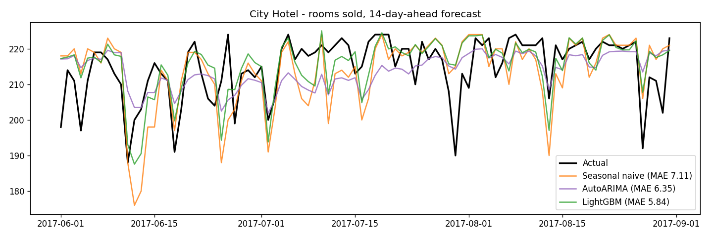

# Hotel Demand Forecasting & Price Suggestion

Forecast how many rooms a hotel will sell each day, 14 days ahead, then suggest a room price from that forecast.

## Problem

Hotels need to know future demand early to set prices and plan staff. This project:

1. Turns 119k booking records into a daily "rooms sold" time series per hotel.
2. Compares a seasonal naive baseline, AutoARIMA and LightGBM.
3. Uses the forecast to suggest a daily price (simple, explainable rules).

## Data

[Hotel Booking Demand](https://www.kaggle.com/datasets/jessemostipak/hotel-booking-demand) (Antonio, Almeida & Nunes, 2019): bookings of a city hotel and a resort hotel in Portugal, arrivals from Jul 2015 to Aug 2017.

Download `hotel_bookings.csv` and put it in `data/raw/`.

## Key findings from EDA

Full analysis: [`notebooks/01_eda.ipynb`](notebooks/01_eda.ipynb)

- 42% of City Hotel and 28% of Resort Hotel bookings are canceled; the longer the lead time, the higher the cancel rate (10% → 68%).
- Strong yearly cycle: the City Hotel sells ~105 rooms/day in January vs ~218 in August. Both hotels are often full in summer.
- Price follows demand: Resort Hotel ADR goes from ~53 EUR in winter to ~190 EUR in August. When the hotel is full, ADR still varies a lot, so there is room to raise prices on forecast "full" days.

## Method

| Step | Detail |
|---|---|
| Daily series | Non-canceled bookings, each counts as 1 room per night of stay |
| Split | Train 2015-08 → 2017-02 (first month skipped: incomplete), Valid 2017-03 → 05, Test 2017-06 → 08 |
| Features | Weekday, month, day of year, lags ≥ horizon (no leakage), rolling mean/std |
| Models | Seasonal naive (same weekday, 14 days earlier) · AutoARIMA (weekly season, rolling origin) · LightGBM on the residual (actual − naive, early stopping) |
| Evaluation | Every test day is forecast exactly 14 days ahead, for all models |
| Pricing | Occupancy = forecast / capacity (95th percentile of rooms sold) → price multiplier |

## Results (test period Jun–Aug 2017, horizon = 14 days)

| Hotel | Model | MAE | RMSE | MAPE |
|---|---|---|---|---|
| City Hotel | Seasonal naive | 7.11 | 9.64 | 3.37% |
| City Hotel | AutoARIMA | 6.35 | 8.21 | 3.01% |
| City Hotel | **LightGBM (residual)** | **5.84** | **7.60** | **2.78%** |
| Resort Hotel | Seasonal naive | 5.67 | 7.52 | 3.25% |
| Resort Hotel | AutoARIMA | 4.88 | **6.12** | 2.78% |
| Resort Hotel | **LightGBM (residual)** | **4.76** | 6.36 | **2.75%** |

- LightGBM lowers MAE by 18% (City) and 16% (Resort) vs the seasonal naive baseline, and has the lowest MAE for both hotels.
- For the Resort Hotel, AutoARIMA is very close and even has a lower RMSE (fewer large errors).
- The test period is high season, when both hotels are almost full, so errors are small for every model.



## How to run

```bash
python -m venv .venv
.venv\Scripts\activate            # Windows
pip install -r requirements.txt

# Optional: test with fake data first
python src/sample_data.py

python src/data_prep.py           # -> data/processed/daily_demand.csv
python src/train.py --hotel "City Hotel"
python src/train.py --hotel "Resort Hotel"
python -m pytest -q
```

Outputs go to `reports/`: metrics (JSON), forecast + suggested price per day (CSV), chart (PNG).

### Optional: BigQuery ML

`bigquery/` has an upload script and ARIMA_PLUS SQL to run the same comparison in BigQuery ML
(works in the free BigQuery sandbox). Not run yet.

## Project structure

```
src/
  config.py       settings (paths, split dates, horizon)
  data_prep.py    bookings -> daily series
  features.py     calendar + lag features
  models.py       seasonal naive, residual LightGBM
  arima.py        AutoARIMA (statsforecast), rolling origin
  evaluate.py     MAE, RMSE, MAPE
  pricing.py      price suggestion rules
  train.py        full pipeline
notebooks/        EDA
bigquery/         optional BigQuery ML scripts
tests/            unit tests
```

## Lesson learned

The first version trained LightGBM on the raw target and dropped every row with a missing `lag_364`.
That left only 245 training rows; for the Resort Hotel, early stopping kept 1 tree and the model
predicted close to the yearly average (MAE 28 vs 5.7 for the baseline). Fix: keep rows with missing
long lags (LightGBM handles NaN) and learn the correction to the naive forecast, so a weak model
falls back to the baseline instead of the average.

## Limitations and next steps

- The dataset has no room count, so capacity is estimated.
- Pricing rules are hand-made, not learned from price elasticity.
- The test period is only high season; a rolling backtest over the whole year would be a stronger check.
- Data is from Portugal (2015–2017), so patterns may differ from Vietnamese hotels.
